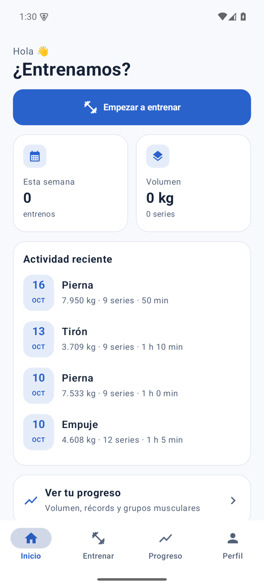
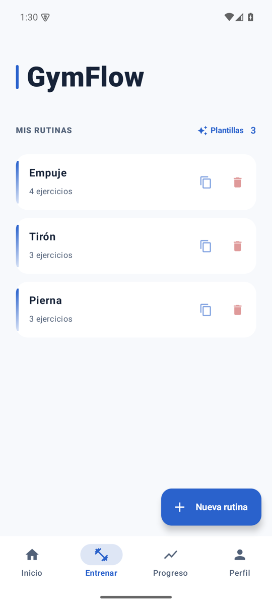
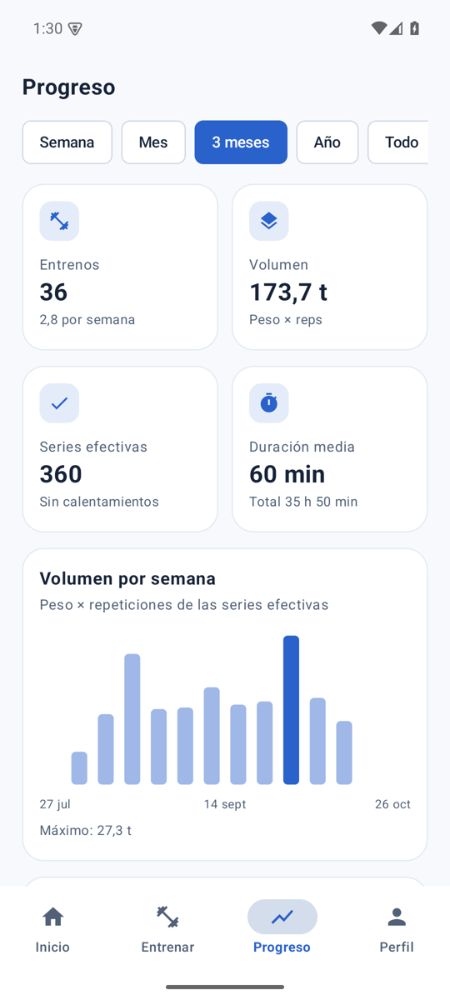
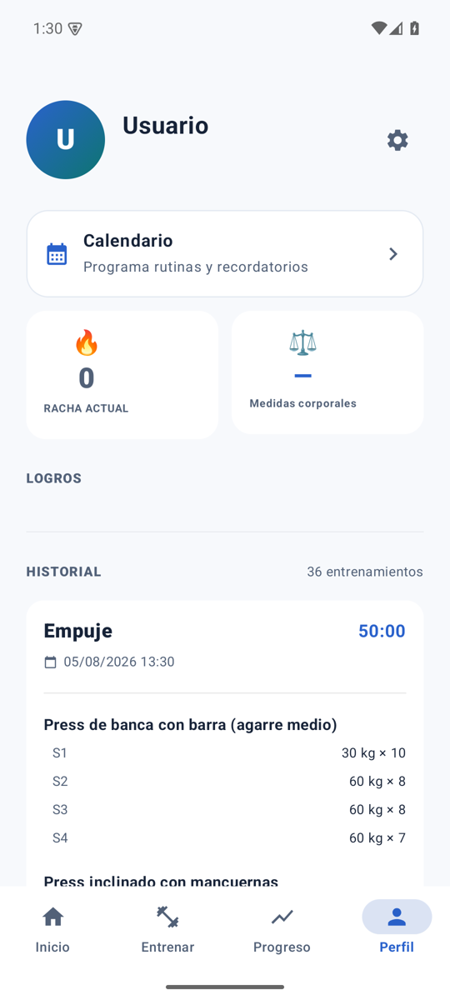
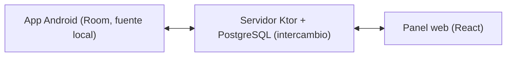

# GymFlow

App de entrenamiento de fuerza gratuita, **offline-first** y **autoalojada** (sin suscripción): todo se queda en tu móvil y, si quieres, en tu propio servidor.

## Descargar

<!-- TODO: enlace a la release cuando exista -->
APK disponible en Releases.

## Capturas

| Inicio | Rutinas | Progreso | Perfil |
|---|---|---|---|
|  |  |  |  |

<!-- TODO: captura del panel web -->

## Funcionalidades

### App Android
- **Rutinas**: plantillas de entrenamiento con ejercicios y series.
- **Entreno activo** con cronómetro de descanso configurable (sonido + vibración, también en segundo plano).
- **Recuperación del entreno en curso**: si la app se cierra o el proceso muere a medias, el entreno se recupera al reabrir, sin duplicarlo.
- **Historial** de entrenos realizados.
- **Récords personales (PR)** y **1RM estimado** (fórmula de Brzycki) por ejercicio.
- **Mapa muscular**: qué grupos musculares has trabajado en los últimos días, con ilustraciones propias.
- **Medidas corporales** (peso y otras medidas) a lo largo del tiempo.
- **Calendario de rutinas programadas** con notificaciones/recordatorios.
- **Exportar e importar datos** (copia propia en JSON/CSV; importación con vista previa y sin sobrescribir nunca lo existente).
- **Compartir un entreno** como tarjeta/texto.
- **Sincronización multidispositivo** con un servidor propio (opcional): varios móviles con la misma cuenta mantienen los mismos datos.
- **Vincular el panel web** desde la app mediante un código de un solo uso.
- Inicio de sesión con **Firebase Auth** (Google / correo).
- Catálogo de ejercicios y app **en español** (nombres e instrucciones traducidas; ver "Estado y próximos pasos").
- Nutrición **no existe en la app**: solo se gestiona desde el panel web.

### Panel web
- **Resumen**, **Entrenamientos**, **Rutinas** y **Estadísticas** (por ejercicio y por medidas corporales) de los datos del usuario.
- **Nutrición** (comidas, macros y objetivos): únicamente disponible cuando el panel está vinculado a un servidor (lee y escribe).
- Puede visualizar datos de tres orígenes: un archivo exportado desde la app, una demo local, o un servidor vinculado en vivo.
- Vinculación por código de un solo uso generado desde la app (token de solo lectura, salvo nutrición).

## Arquitectura



La app funciona sin red: Room es la única fuente de datos en el móvil. El servidor propio (Ktor + PostgreSQL) es un punto de intercambio opcional entre dispositivos del mismo usuario, desactivado por defecto. La lógica de sincronización, resolución de conflictos y migraciones vive en `syncCore`, un módulo Kotlin/JVM puro compartido y probado fuera de Android. El panel web lee (y, solo en nutrición, escribe) los datos a través del servidor.

Detalle completo: [`docs/ARQUITECTURA.md`](docs/ARQUITECTURA.md).

## Stack

**Android** — Kotlin, Jetpack Compose (BOM 2025.04.01) + Material 3, Room 2.6.1, Firebase Auth (BOM 33.1.0), Google Sign-In / Credentials Manager 1.5.0, WorkManager 2.10.0, kotlinx.serialization 1.7.3. `compileSdk`/`targetSdk` 35, `minSdk` 26.

**Servidor** (`server/`) — Kotlin 2.0.21, Ktor 3.0.3, PostgreSQL (JDBC 42.7.4) + HikariCP 5.1.0, Flyway 10.20.1 (migraciones), Logback 1.5.12.

**Núcleo de sincronización** (`syncCore/`) — Kotlin/JVM puro 2.0.21, kotlinx.serialization y kotlinx.coroutines; sin Android, para poder probarse en la JVM.

**Panel** (`panel/`) — React 19.2, TypeScript ~6.0, Vite ^8.3.

**Despliegue** (`deploy/`) — Docker Compose (PostgreSQL 16, servidor, Caddy 2 con HTTPS automático).

## Estructura del repo

```
app/        App Android (Kotlin + Jetpack Compose, Room)
syncCore/   Núcleo de importación y sincronización (Kotlin/JVM puro, sin Android)
server/     Servidor Ktor + PostgreSQL (sincronización, emparejamiento, nutrición)
panel/      Panel web en React + TypeScript (lectura de datos y nutrición)
deploy/     Docker Compose + Caddy para desplegar servidor y panel en una VM
contract/   Casos de ejemplo compartidos entre cliente y servidor (formato de export/sync)
docs/       Documentación técnica (arquitectura, capturas)
```

## Cómo ejecutarlo

**App Android**: abre la raíz del proyecto en Android Studio y compila/ejecuta el módulo `app` (requiere `compileSdk` 35). Opcionalmente, añade `gymflow.syncUrl=https://tu-servidor` en `local.properties` para apuntar a un servidor propio (también se puede configurar luego desde la app, en Perfil → Sincronización).

**Servidor en local** (con PostgreSQL embebido, sin Docker):
```bash
cd server && ./gradlew runDev
```

**Panel en local**:
```bash
cd panel && npm install && npm run dev
```

**Despliegue en una VM** (Docker Compose + Caddy, HTTPS automático): ver [`deploy/README.md`](deploy/README.md).

## Tests

| Módulo | Comando |
|---|---|
| App — JVM (`test/`) | `./gradlew :app:testDebugUnitTest` |
| App — instrumentados (`androidTest/`, requieren dispositivo/emulador) | `./gradlew :app:connectedDebugAndroidTest` |
| `syncCore` (JVM puro, se construye por separado) | `cd syncCore && gradle test` |
| Servidor (Ktor, con PostgreSQL embebido en los tests) | `cd server && ./gradlew test` |
| Panel | `cd panel && npm test` |

## Estado y próximos pasos

- [x] Icono propio de la app (icono adaptativo, `app/src/main/res/mipmap-*`).
- [ ] Terminar de revisar manualmente las instrucciones de ejercicios en español: la mayoría ya están traducidas, pero quedan ~112 marcadas como dudosas/desactualizadas por revisar y 5 ejercicios sin instrucciones traducibles.
- [ ] Ilustraciones 3D de ejercicios (hoy el mapa muscular usa ilustraciones 2D propias).
- [ ] Release firmada de la app (hoy solo hay firma de depuración, pensada para pruebas en los móviles del autor).

## Autor

**Xavi Martínez** — [github.com/xavki](https://github.com/xavki)
