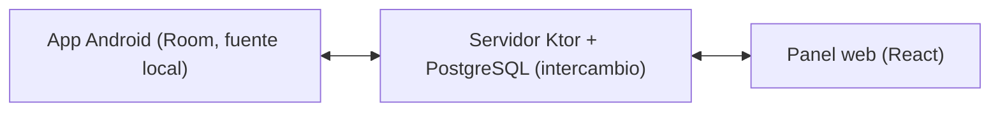

# Arquitectura de GymFlow

Documento vivo con las decisiones técnicas vigentes en el código. Si una decisión cambia, actualizar aquí.

## 1. Visión general (offline-first)

- **Room** (`gymflow.db`) es la única fuente de datos en el móvil. La app funciona sin red: entrenos, rutinas,
  historial, estadísticas y el entreno en curso no dependen del servidor.
- El **servidor propio** (Ktor + PostgreSQL, `server/`) es un punto de intercambio opcional entre dispositivos del
  mismo usuario, desactivado por defecto (URL vacía). No es la fuente de verdad: cada móvil decide qué sube y cuándo.
- El **panel web** (React, `panel/`) lee los datos del usuario a través del servidor con un token de solo lectura
  obtenido por emparejamiento (ver §5), y es el único sitio donde se gestiona nutrición (ver §6).
- Un único mecanismo de sincronización: la lógica compartida y probada en JVM vive en el módulo `syncCore`
  (Kotlin puro, sin Android ni Ktor), consumido tanto por la app como por el servidor.

## 2. Protocolo de sincronización, revisiones y conflictos (`syncCore`)

- **Modelo**: control de versiones optimista. Cada fila tiene una revisión (`rev`) asignada por el servidor y el
  cliente guarda el `baseRev` con el que la leyó. No se usa la hora del móvil para decidir conflictos.
- **Push** (`PushChange{table,id,baseRev,updatedAt,deletedAt,data,group}`): el servidor acepta si la fila no existe
  (`rev` 1) o si `baseRev == rev` (incrementa `rev`); si el contenido coincide, responde `unchanged` sin mover nada;
  si no coincide, responde `conflict` con la versión del servidor.
- **Agregados atómicos**: la sincronización sube y aplica agregados completos (p. ej. una rutina o un entreno con
  todas sus filas), nunca filas sueltas, para no mezclar versiones a medio camino. Si una fila del agregado difiere
  de lo remoto, el agregado entero queda congelado como conflicto; el resto sigue avanzando.
- **Descarga por páginas, aplicación atómica**: el cliente descarga todas las páginas pendientes y las aplica en una
  sola transacción junto con el avance del cursor; un corte de red a mitad no deja avance parcial (es seguro
  reintentar: idempotente por contenido).
- **Resolución de conflictos** es por agregado completo, con dos opciones explícitas en la UI:
  - *Conservar este dispositivo*: sube la versión local (rebasa la revisión); lo que solo existe en el servidor se
    retira con un tombstone (no se resucita nada borrado).
  - *Usar el servidor*: antes de sustituir, archiva la versión local **actual** completa en `sync_archive`; si hubo
    ediciones posteriores al momento de detectar el conflicto, exige una segunda confirmación explícita en la UI
    para no perder esa edición silenciosamente.
  - No hay fusión campo a campo (requeriría una versión base común); la resolución automática solo ocurre si el
    contenido es idéntico.
- **Identidad**: toda operación (importar, incorporar, sincronizar, resolver) se ata a la identidad
  (`uid|servidor`) con la que se preparó, y se revalida contra la identidad viva antes de confirmar cada
  transacción. Un cambio de cuenta a mitad de operación no escribe nada con la cuenta nueva.
- **Aislamiento entre usuarios**: las escrituras resuelven el propietario real por SQL (cadena de padres) y nunca
  usan `INSERT OR REPLACE` por id; una fila ajena con el mismo id no se puede pisar.
- **Importación JSON** (copia exportada de otro móvil) y la **incorporación inicial** (primera vez que un
  dispositivo se conecta al servidor) nunca sobrescriben: lo idéntico se omite, lo distinto queda como conflicto
  visible, y toda la operación es transaccional (todo o nada).

## 3. Migraciones de Room y cómo se prueban

- `GymDatabase` está en **versión 4** (`app/src/main/java/com/gymflow/data/GymDatabase.kt`), con
  `exportSchema = true`; los esquemas exportados (`1.json`…`4.json`) viven en `app/schemas/` y se usan como fixture
  de las pruebas de migración.
- Migraciones registradas en `Migrations.ALL` (`Migrations.kt`):
  - `MIGRATION_1_2`: añade la columna `dirty` a las tablas de datos y reconstruye las tablas hijas (SQLite no
    permite quitar claves foráneas con `ALTER`).
  - `MIGRATION_2_3`: solo crea las tablas nuevas de sincronización (`sync_state`, `sync_conflicts`, `sync_archive`,
    `sync_revs` con su clave original); no toca ninguna fila ni tabla de datos existente.
  - `MIGRATION_3_4`: cambia la clave de `sync_revs` a `(userId, serverKey, tableName, id)` para aislar las
    revisiones por cuenta, reasignando cada revisión existente a su usuario propietario; tampoco toca tablas de
    datos. El SQL vive en `syncCore` (`RoomMigrationSql`), en Kotlin puro, para poder probarlo en JVM con
    SQLite real sin depender de Android.
- Las migraciones se verifican en dos niveles: pruebas de `syncCore` que ejecutan el SQL de migración sobre
  SQLite real (sqlite-jdbc) y comprueban el esquema resultante y la conservación de datos, y pruebas instrumentadas
  de Room (`MigrationTestHelper`, `androidTest`) que validan los esquemas exportados contra la base real en un
  emulador.

## 4. Borrador del entreno en curso (`ActiveWorkoutStore`)

- **No vive en Room**: un entreno a medias no debe sincronizarse ni aparecer en el historial, y una tabla nueva
  exigiría migración. Se guarda como archivo privado por usuario (`active_workout_<uid>.json`), con escritura
  atómica (temporal + renombrado) y copia `.bak` de la versión anterior; un archivo dañado se aparta como
  `.corrupt` en lugar de perderse.
- Se recupera al abrir la app con el mismo usuario; la duración se recalcula desde la hora de inicio (reloj de
  pared), no desde un contador que pudiera perderse si el proceso muere.
- **Finalizar en dos pasos**: primero se escribe un "pendiente de guardar" (`PendingFinish`) y se borra el
  borrador; después se guarda en Room con el mismo id (repetir el paso no duplica) y solo entonces se borra el
  pendiente. Si Room falla o el proceso muere entre medias, el pendiente se reintenta al reabrir la app.
- "Descartar" elimina el borrador sin pasar por Room.

## 5. Autenticación y emparejamiento de dispositivos

- **App ↔ servidor**: la app se autentica con un ID token de Firebase Auth. El servidor valida la firma de
  Google, el emisor y la audiencia (su propio proyecto de Firebase) contra las claves públicas JWKS; el UID sale
  únicamente del token verificado, nunca de un parámetro de la petición.
- **Panel ↔ servidor**: el panel no usa Firebase. Se autentica con un token de solo lectura obtenido por
  **emparejamiento** (`PairingRepository`, servidor): la app (ya autenticada) pide un código corto de un solo uso
  que caduca en 10 minutos; el panel lo introduce y el servidor lo cambia por un token de panel ligado al UID. Un
  token de panel puede leer todos los datos del usuario, pero solo puede escribir nutrición (ver §6).
- Los datos de cada usuario están aislados por `user_id` en todas las tablas y consultas del servidor.

## 6. Nutrición: solo en servidor y panel

- El modelo y la lógica de nutrición (`NutritionModels.kt`, `NutritionRepository.kt`, `NutritionRoutes.kt`) viven
  únicamente en `server/`. El panel web es la única interfaz que lee y escribe nutrición.
- La app Android no tiene entidades, pantallas ni lógica de nutrición: no forma parte de Room ni de `syncCore`.
